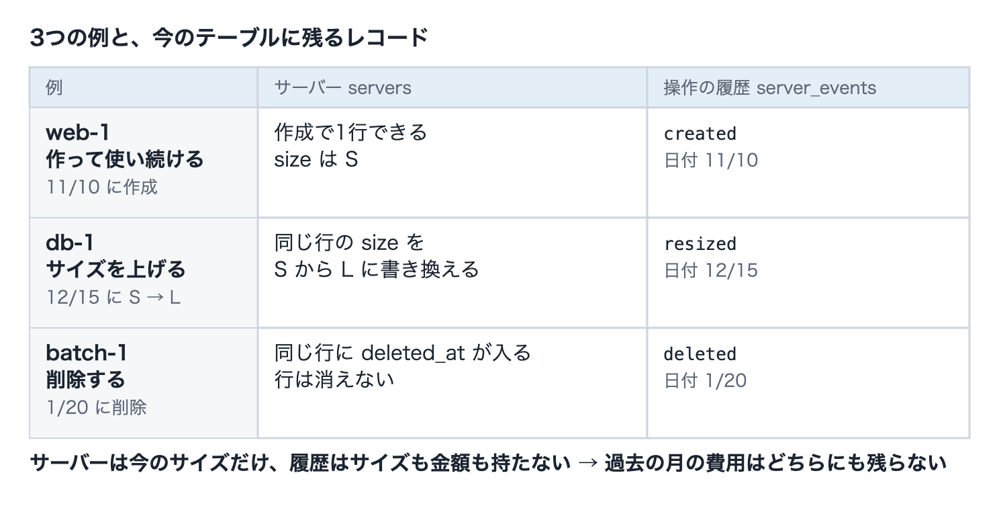
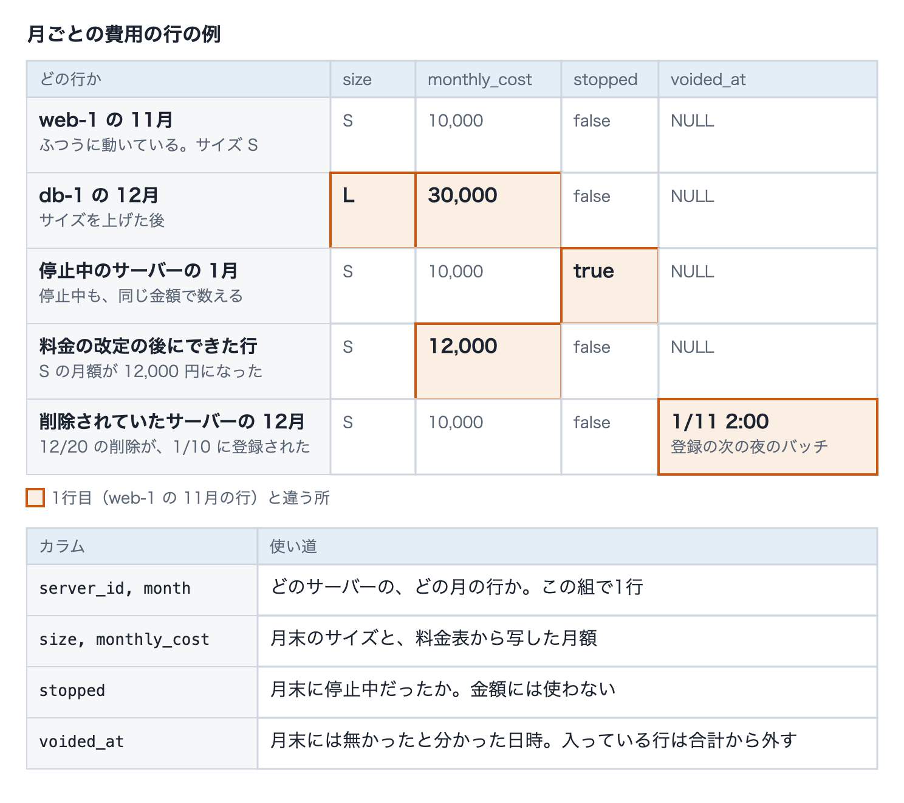
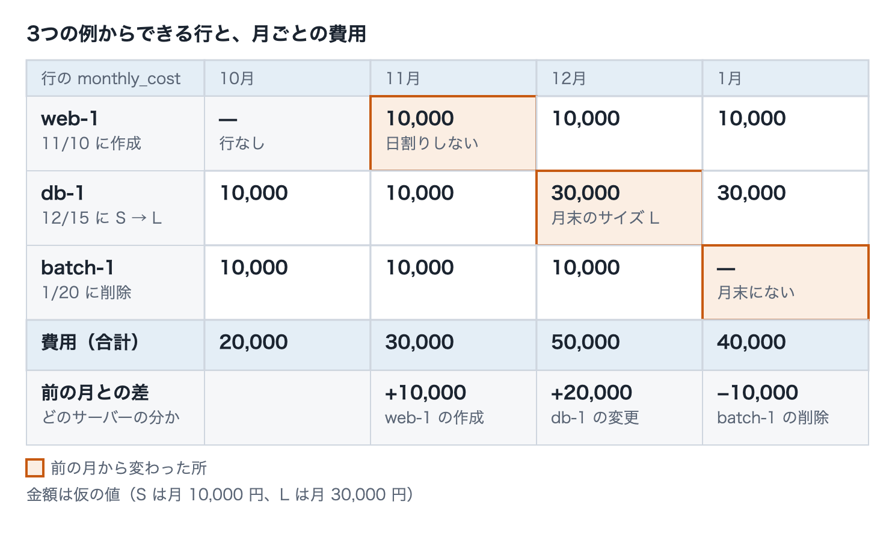

# design-explainer

設計を人にレビューしてもらうための**説明ページ**を作る、[Claude Code](https://claude.com/claude-code) 用の Agent Skill です。

作るのは仕様書ではありません。読み手が5分で読んで、「この設計に大きな抜けがないか」を判断できるページです。そのために、設計の全部を載せるのではなく、判断に要るものだけを図にして見せます。

データモデル、バッチ、データの流れの設計を、図の入った Notion のページにまとめる使い方を想定しています。

> A Claude Code skill that turns a design into a short, diagram-first explainer page that reviewers can read in about five minutes and judge whether anything big is missing. It agrees on the purpose and outline before drawing anything, follows a fixed page shape (current state → process → stored records → results → exceptions → downstream), carries the same three concrete examples through every figure that shows examples, renders figures to PNG with a small Python helper (SVG + headless Chrome), and checks the page by having an independent subagent read it once and answer questions without looking back. The skill text is written in Japanese.

## 何をするか

設計の説明を頼むと、メモや ER 図の中身を全部載せた長いページになりがちです。読み手は、どこを見ればよいのかが分からなくなります。このスキルは、次の3つを守って、5分で読めるページを作ります。

- 図と本文を作り始める前に、ページの目的と構成の案を依頼した人に見せて、了承をもらう
- 1つの節は、図1枚と1〜3文にする
- 例を出す図では、最初から最後まで同じ3つの例を使う

下の3枚は、スキルに入っている見本の図です。題材は架空の設計です。社内で貸し出している検証用サーバーの費用を、毎晩のバッチで月ごとに1行ずつ残します。月末にあるサーバーを、そのときのサイズの月額で1か月分として数える、という設定です。

1枚目は、3つの例（web-1、db-1、batch-1）と、今のテーブルに残るレコードです。



2枚目は、新しく残す行の例と、カラムの使い道です。いちばんふつうの場合の行を基準として1行目に置き、基準と違う所だけに色を付けています。



3枚目は、1枚目と同じ3つの例から、月ごとの結果がどうなるかを見せています。色は、前の月から変わった所に付けています。



### 流れ

| 段階 | やること |
|---|---|
| 1. 目的を確かめる | 誰が読んで、何を判断するのか、何分で読むのかを1文にする。既定は5分 |
| 2. 材料を確かめる | 依頼のメモ、元の設計ページ、コードを読み直す。確かめられないものは「未確認」と書く |
| 3. 構成の案を出して止まる | 最後まで使う3つの例、節と図の一覧、聞きたいことを1つのメッセージで出す。了承をもらうまで、図も本文も作らない |
| 4. 図を作る | 付属の `figkit.py` で SVG を組み、headless Chrome で PNG にする。文字がセルや図の幅に入らない行は、書き出すときに知らせる |
| 5. 本文を書いて字数を数える | 5分で読める量を、図の中の文字を含めて約2,500字と見積もる（1分に500字）。超えたら削るか、ページの最後に折りたたんで置く「参考」の節へ移す |
| 6. 別のエージェントに確かめさせる | 読み手の役をするエージェントに、会話の経緯を渡さずに1回だけ読ませる。ページの目的から作った8〜10個の問いに、見返さずに答えさせる。答えが外れた所を直す |
| 7. Notion に載せて画面で見る | 置き場所を依頼した人に確かめてから、図をアップロードしてページを作り、ブラウザで表示を確かめる |
| 8. 報告する | URL、字数、確かめた結果、未確認の点、読み手の役をしたエージェントから出た設計への疑問 |

ページは「今のテーブルにどう残っているか → バッチなどの処理が1回ですること → 新しく残るレコード → 例で結果を確かめる → 例外にあたる変更が起きたとき → そのテーブルを読む集計や画面での動き」の順に並べます。題材に合わせて節を足し引きしますが、この順は保ちます。

### 特徴

- **構成を合わせる前に作り始めない。** 構成の案は数分で出せますが、作り直しには数時間かかります。急ぎと言われても、先に案を出して止まります
- **例は3つで、最後まで同じものを使う。** 名前、日付、金額を最初に決めて、例を出す図で使い回します。出来事の違う例を並べて、比べられるようにします。数を変えたいときは、構成の案への返事で指定できます
- **色は、1枚の図に1つの意味だけで使う。** 行の例の図では、いちばんふつうの場合の行を基準として1行目に置き、基準と違う所に付けます。結果の図では前の月から変わった所、例外の図ではまだ決まっていない所、というように図ごとに1種類に絞り、凡例に1行で書きます
- **中身が伝わるかどうかを、問いへの答えで確かめる。** 「分からない言葉を挙げて」と頼むだけでは、中身が伝わったかは分かりません。1回だけ読ませて、見返さずに答えさせます
- **未確認、未決定、設計の欠点を隠さない。** テーブルに持たせなかったカラムと、その理由も本文に書きます
- **読み手の役をしたエージェントが設計に疑問を持ったら、ページに足さずに報告する。** こうした疑問は実際のレビューでも聞かれやすく、設計の抜けを指していることがあるからです

## 前提・想定

必要なもの：

- **Claude Code**（Agent Skills が使える環境）。中身が伝わるかどうかの確認にサブエージェントを使います
- **Python 3**。`figkit.py` は標準ライブラリだけで動きます
- **Google Chrome か Chromium**。図を PNG にするときに headless で起動します。探す場所は、macOS では `/Applications` の Google Chrome と Chromium、Linux では `/usr/bin` の `google-chrome`、`chromium`、`chromium-browser`、Windows では `C:\Program Files\Google\Chrome\Application\chrome.exe` です。ほかの場所にあるときは、環境変数 `FIGKIT_CHROME` に実行ファイルの場所を入れてください。見つからないと、その旨を表示して止まります
- **日本語のフォント**。ヒラギノ角ゴ、游ゴシック、Noto Sans CJK JP の順に使います

Notion に載せるときに要るもの：

- **Notion の MCP サーバー**（[Notion MCP](https://developers.notion.com/docs/mcp)）。ページの作成と、画像のアップロードに使います。無い環境では、本文の markdown と図の PNG をファイルで作るところまでになります
- **ブラウザを操作できるツール**（Claude in Chrome など）。載せたページの見た目を確かめるときに使います

確かめた環境と、対象にしている設計：

- 図の書き出しは macOS の Google Chrome で確かめています。Linux と Windows では確かめていません
- スキルの文面と図の文字は日本語です
- 対象は、データモデル、バッチ、データの流れの設計です。実装者向けの仕様書、ADR、PR の本文には向きません

## インストール

```bash
git clone https://github.com/kodera123/design-explainer.git
```

```bash
mkdir -p ~/.claude/skills
```

```bash
cp -R design-explainer/skills/design-explainer ~/.claude/skills/
```

プロジェクト単位で使う場合は、`~/.claude/skills/` の代わりに `<project>/.claude/skills/` に置きます。コピーした後に始めたセッションから使えます。新しい版に上げるときは、`git pull` をしてから、もう一度コピーしてください。

## 使い方

設計のメモを貼るか、メモのファイルや元の設計ページの場所を伝えて、Claude Code で次のように頼むと起動します。

```
/design-explainer docs/point-design.md の設計を、チームにレビューしてもらう説明ページにして
```

「設計書を作って」「設計をまとめて」「図解して整理して」「抜けがないか見てもらいたい」などでも起動します。「設計書を作って」と頼んだ場合も、できるのはレビュー用の説明ページです。作ったページを「見づらい」「量が多い」と言われたときの直しにも使えます。

最初に返ってくるのは、ページそのものではなく構成の案です。例、節と図の一覧、聞きたいことが並ぶので、「これで作って」と返すか、直したい所を伝えてください。

見本の図は、次のコマンドで書き出せます。出力先のフォルダに、図ごとの HTML と PNG ができます。

```bash
python3 ~/.claude/skills/design-explainer/scripts/example_figures.py <出力先のフォルダ>
```

字数はスキルが手順の中で数えますが、手で数えるときは次のコマンドを使います。本文の markdown と、図と一緒にできる HTML を渡します。図の中の文字は HTML から数えます。本文のうち「参考」の見出しから後ろは、読む時間に入れずに別に数えます。

```bash
python3 ~/.claude/skills/design-explainer/scripts/figkit.py count 本文.md 図1.html 図2.html
```

## ファイル構成

```
skills/design-explainer/
├── SKILL.md                      # 手順、ページの型、図と文の決まり、よくある失敗
├── references/
│   ├── outline-example.md        # 構成の案の書き方と見本、案への返事の読み方
│   ├── comprehension-check.md    # 別のエージェントに読ませるときの頼み方
│   └── notion-publish.md         # Notion に図を載せる手順と、画面で見る点
└── scripts/
    ├── figkit.py                 # 図を作る部品（表、手順の流れ、左から右への流れ、凡例、折り返し、字数の見積もり）
    └── example_figures.py        # figkit の動く見本。ページの型の節ごとに、7種類の図を描く
```

## カスタマイズ

- **ページの型**（`SKILL.md` の表）は、データを残す設計に合わせてあります。画面の設計や API の設計に使うなら、節の並びを書き換えてください
- **図の色、幅、フォント**は `figkit.py` の先頭の CSS と定数で変えられます
- **読む時間**を変えるときは、字数の目安（5分で約2,500字）を合わせて変えてください
- **見本**（`references/outline-example.md` と `scripts/example_figures.py`）は、自分のチームのレビューで読みやすいと言われた説明ページがあれば、それに差し替えてください。できるページが、チームの書き方に近づきます

## ライセンス

[MIT](LICENSE)
